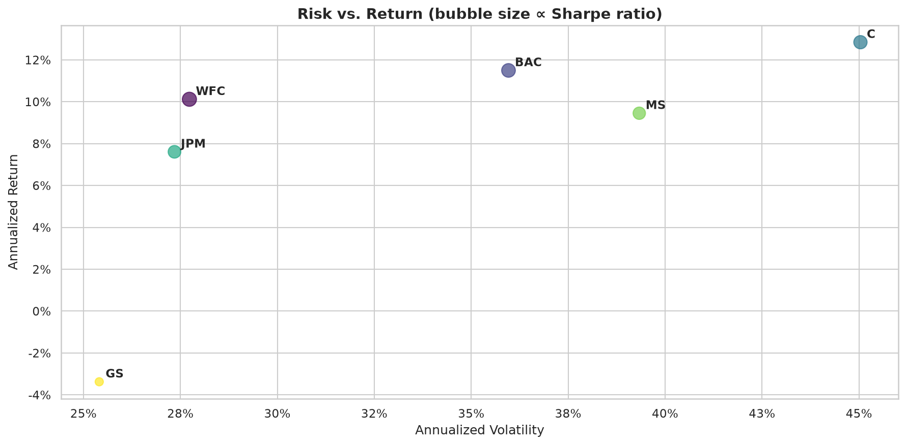
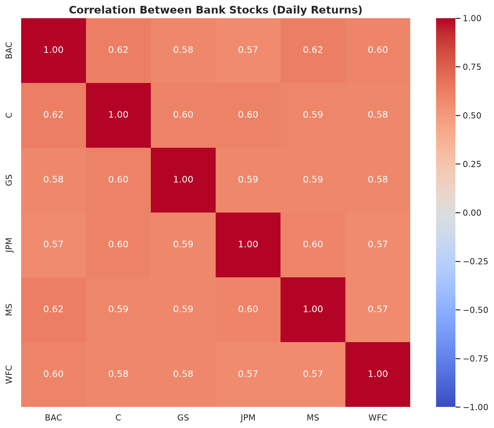
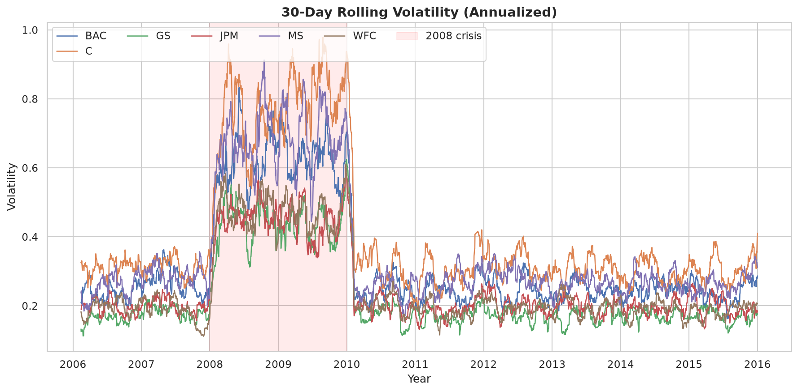
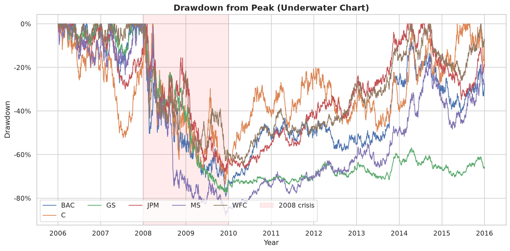
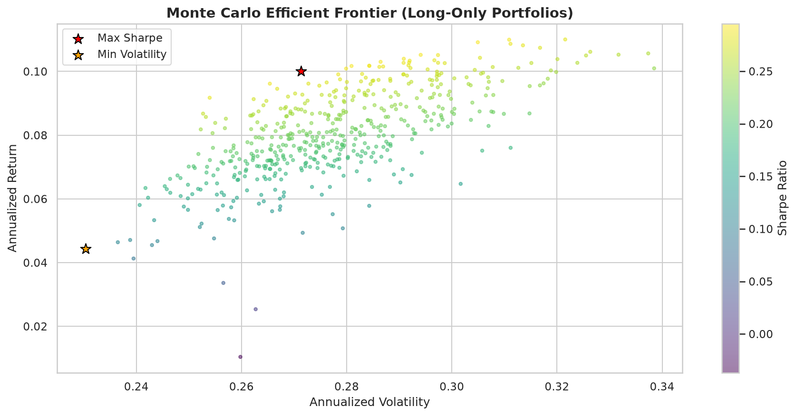
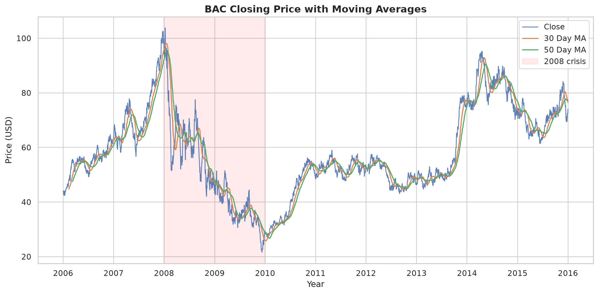

# 📈 Finance Stock Analysis using Python

Analyzing historical stock performance of **six major U.S. banks (2006–2016)** — returns, risk,
correlations, trends, and portfolios — with clean, tested, reusable Python code.

| Bank | Ticker | Bank | Ticker |
|------|--------|------|--------|
| Bank of America | BAC | JPMorgan Chase | JPM |
| Citigroup | C | Morgan Stanley | MS |
| Goldman Sachs | GS | Wells Fargo | WFC |

---

## 🎯 What this project does

- Collects 10 years of historical prices via **yFinance** (with CSV caching + offline fallback)
- Computes **daily / cumulative / normalized returns**
- Measures risk four ways: **volatility, Sharpe/Sortino ratios, max drawdown, VaR**
- Finds relationships via **correlation analysis**
- Visualizes trends: price history, heatmaps, distributions, moving averages, rolling volatility, drawdowns, risk-vs-return, Monte Carlo efficient frontier
- Ships three ways to run it: **Jupyter notebook, CLI pipeline, Streamlit dashboard**

---

## ✨ What's improved in v2.0

The original project was a single exploration notebook. It is now a structured mini-project:

| Before | After |
|--------|-------|
| One notebook, code only (no narrative) | Notebook with full markdown narrative + 12 sections |
| Plot styling applied at the very end | Consistent global style applied first, shared by all charts |
| Duplicated download cells, brittle column extraction | `src/data.py`: cache → Yahoo → synthetic fallback; handles all yfinance layouts |
| Only std-dev as "risk" | `src/metrics.py`: Sharpe, Sortino, drawdown, VaR/CVaR, rolling vol, annualized stats |
| Throwaway plotting code | `src/plots.py`: 10 reusable chart functions, crisis shading, saved to `images/` |
| No portfolio analysis | `src/portfolio.py`: Monte Carlo efficient frontier, max-Sharpe / min-vol portfolios |
| No tests, no CLI | `pytest` suite (23 tests) + `scripts/run_analysis.py` one-command pipeline |
| Empty `images/` placeholder | 10 generated charts + interactive **Streamlit dashboard** (`app.py`) |

---

## 📁 Project structure

```text
finance-stock-analysis/
├── finance_project.ipynb      # Main analysis notebook (narrative + charts)
├── app.py                     # Interactive Streamlit dashboard
├── src/
│   ├── config.py              # Tickers, dates, parameters, paths (single source of truth)
│   ├── data.py                # Download / cache / clean / synthetic fallback
│   ├── metrics.py             # Returns, volatility, Sharpe, drawdown, VaR, correlations
│   ├── plots.py               # All chart functions (one style, reusable)
│   └── portfolio.py           # Monte Carlo portfolios & efficient frontier
├── scripts/
│   └── run_analysis.py        # Headless end-to-end pipeline (charts + CSVs + findings)
├── tests/
│   └── test_metrics.py        # 23 unit tests (no network needed)
├── data/                      # summary.csv, correlation.csv (price cache is git-ignored)
├── images/                    # Generated charts
├── requirements.txt           # Core deps
└── requirements-dev.txt       # + pytest, streamlit
```

---

## 🚀 How to run

### 1. Setup

```bash
git clone https://github.com/vanshi13rathore/finance-stock-analysis.git
cd finance-stock-analysis
pip install -r requirements.txt
```

### 2a. Jupyter notebook (start here)

```bash
jupyter notebook finance_project.ipynb
```

Run all cells top to bottom. It loads live Yahoo data when online, otherwise uses a
reproducible synthetic dataset — and always tells you which source was used.

### 2b. CLI pipeline (reproduce everything headless)

```bash
# Live data → charts in images/, CSVs in data/, findings in terminal
python scripts/run_analysis.py

# Fully offline demo with synthetic data
python scripts/run_analysis.py --synthetic --no-cache
```

### 2c. Interactive dashboard

```bash
pip install -r requirements-dev.txt
streamlit run app.py
```

Explore prices, risk, correlations, and portfolios with ticker/date/risk-free controls.

### 2d. Tests

```bash
pytest tests/ -q   # 23 passed, no network required
```

---

## 📊 Methodology cheat-sheet

| Metric | Formula |
|--------|---------|
| Daily return | `P_t / P_{t-1} − 1` |
| Annualized volatility | `std(daily) × √252` |
| Sharpe ratio | `(ann_return − r_f) / ann_vol` |
| Sortino ratio | same, but only downside volatility in the denominator |
| Max drawdown | `min((P − running_max) / running_max)` |
| VaR 95% (daily) | 5th percentile of daily returns |
| Growth of $1 | `cumprod(1 + daily_returns)` |

Annualization assumes 252 trading days; default risk-free rate is 2%.

---

## 📈 Key findings (live Yahoo Finance data, 2006–2016)

- **Citigroup (C)** showed the **highest volatility** — the crisis hit it hardest.
- **Goldman Sachs (GS)** was relatively the **most stable** (lowest volatility).
- **Bank of America (BAC)** and **Wells Fargo (WFC)** had the **strongest positive correlation**.
- Market **volatility spiked dramatically during the 2008–2009 financial crisis** (visible in every rolling-volatility and drawdown chart).
- Bank stocks are strongly correlated with each other (~0.6–0.9), so diversification *within* the sector is limited — the efficient-frontier demo quantifies this.

> The charts below were rendered from the reproducible offline demo dataset
> (`python scripts/run_analysis.py --synthetic`) so they are identical on every machine.
> Run the notebook or CLI with internet access to regenerate them from live Yahoo data —
> the headline patterns above hold in both.

---

## 📷 Sample visualizations

### Risk vs. return (bubble size ∝ Sharpe ratio)



### Correlation heatmap



### 30-day rolling volatility (annualized)



### Drawdown from peak



### Monte Carlo efficient frontier



### BAC with 30/50-day moving averages



---

## 🎓 Learning outcomes

- Working with real-world financial data (and handling API quirks / offline mode)
- Exploratory data analysis with pandas + seaborn
- Return, risk, and risk-adjusted performance metrics
- Correlation analysis and portfolio intuition (efficient frontier)
- Structuring analysis code into testable modules
- Reproducible pipelines (CLI + pinned deps + tests) and interactive dashboards

## 🔮 Future improvements

- [ ] CAPM beta vs. S&P 500 benchmark
- [ ] Constrained portfolio optimization (scipy) with target return / max weight
- [ ] Regime detection (bull / bear / crisis clustering)
- [ ] ML-based forecasting (ARIMA / gradient boosting / LSTM)
- [ ] Dividend- and split-adjusted total-return analysis

---

## 👩‍💻 Author

**Vanshika Rathore** — B.Tech Computer Science Engineering (AI & ML)

GitHub: https://github.com/vanshi13rathore

## ⭐ If you found this project useful, consider giving it a Star!
